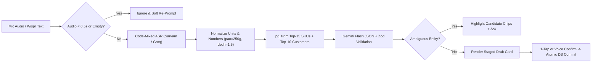

# API & Voice Extraction Pipeline (`apps/api` + `packages/shared`)

## 1. Voice-to-Commit Pipeline (Zero Blind DB Writes)

### Mandatory Voice Rules
1. **No English Pivot:** Never run `Regional -> English Translation -> NLU`. Pass the code-mixed transcript + shop-specific SKU/customer candidates directly to Gemini Flash structured output.
2. **Draft First, Always:** `/api/v1/voice/parse` is **read-only**—it returns a `TransactionDraft` (`packages/shared/src/contracts.ts`) and never touches `ledger_entries` or stock tables.
3. **Mid-Flow Corrections:** Passing `activeDraft` alongside a new utterance (`"Nahi, 2 nahi 1 kilo"`) patches the staged draft in place without creating a second bill.
4. **Noise & Timeout Resilience:** Rate-limited (`@fastify/rate-limit`), clips `< 0.5s` rejected client-side, fallback quick-tap catalog continues working when offline.

---

## 2. Parameterized Voice Q&A (*"Bol ke Poocho"*)

Never allow an LLM to generate raw SQL against financial tables. The parser selects an audited `queryId` + typed parameters:

| Intent `queryId` | Example Spoken Query | Server Action |
| :--- | :--- | :--- |
| `EOD_CASH_SUMMARY` | *"Aaj galla mein kitna cash hona chahiye?"* | Runs deterministic drawer cash + UPI sum query |
| `CUSTOMER_BALANCE` | *"Ramesh ka kitna baaki hai?"* | Sums `ledger_entries` for matched `customer_id` |
| `EXPIRY_AT_RISK` | *"Kaunsa saaman expire hone wala hai?"* | Lists packed batches (`<= 5d`) + stale loose bins |
| `DEAD_STOCK_CAPITAL` | *"Paisa kahan phansa hai?"* | Sums `cost_price_paise * qty` for 30-day zero-sale SKUs |
| `COST_MARGIN_WHISPER` | *"Basmati kitne ka padta hai?"* | Returns `cost_price_paise` **visual-only** (`suppressTts: true`) |

---

## 3. REST API Contract (`/api/v1/*`)

Every endpoint scopes by authenticated `shopId` and validates request/response payloads using `@voicekhata/shared` Zod schemas.

| Method & Path | Purpose | Key Rules |
| :--- | :--- | :--- |
| `GET /healthz` | Liveness & DB readiness | Returns `HealthResponseSchema` (implemented) |
| `POST /api/v1/shops/onboarding` | Load store preset (`kirana`, `dairy`, etc.) | Seeds starter SKUs + aliases idempotently |
| `POST /api/v1/voice/parse` | Audio/text -> `TransactionDraft` | Read-only; returns candidates if ambiguous |
| `POST /api/v1/transactions/commit` | Commit `SALE` or `PAYMENT` draft | Requires `idempotencyKey`; `FOR UPDATE` FEFO + ledger write |
| `POST /api/v1/invoices/:id/void` | Void or return items | Restores batch qty & inserts `VOID_REVERSAL` ledger entry |
| `POST /api/v1/expenses` | Log *Chhota Kharcha* / Owner Draw | Inserts `cash_expenses` affecting EOD drawer tally |
| `POST /api/v1/inventory/purchase` | Bulk restock intake | Converts `purchase_unit` -> `base_unit`; creates batch or resets loose bin |
| `GET /api/v1/khata` | Customer list + Traffic Light risk | Computes `GREEN / AMBER / RED` respecting `billing_cycle_day` |
| `POST /api/v1/query/ask` | *"Bol ke Poocho"* Voice Q&A | Executes parameterized template; flags `suppressTts` for sensitive stats |
| `GET /api/v1/copilot/daily` | EOD tally + Morning Copilot cards | Returns drawer cash diff, supplier POs, expiry & loose price advisories |
| `POST /api/v1/copilot/actions/:id/approve` | Approve/dismiss copilot card | Only human-approved price/clearance changes execute |
