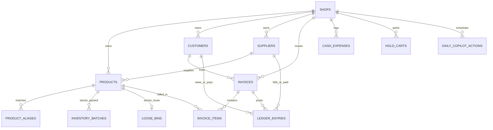

# Database Architecture (`@voicekhata/db` — PostgreSQL 16 + Drizzle ORM)

Current baseline in `packages/db/src/schema.ts` implements `shops` and enables `pg_trgm` via `infra/postgres/init.sql`. Implement the remaining tables below on `feature/backend`.

---

## 1. Non-Negotiable Data Invariants

1. **Tenant Isolation:** Every business table includes `shop_id uuid NOT NULL REFERENCES shops(id)`. All queries must scope by `shop_id`.
2. **Integer Money & Units:** All currency columns use `BIGINT` in **paise** (`₹12.50 = 1250`). All stock quantities use `INTEGER` / `BIGINT` in **base units** (`g`, `ml`, `pcs`). Never store `FLOAT`/`DOUBLE`.
3. **Append-Only Ledger (`ledger_entries`):** Never overwrite customer or supplier balances in place, and never `DELETE` financial rows. Customer due balance = `SUM(debit_paise - credit_paise)`. Void mistakes using `VOID_REVERSAL` entries.
4. **Concurrency Locking:** Deducting `inventory_batches` (FEFO) or `loose_bins` during checkout must run inside `db.transaction(...)` with `SELECT ... FOR UPDATE` ordered by `expiry_date ASC` so parallel checkouts cannot oversell stock.
5. **Idempotency:** `invoices.idempotency_key` (`UNIQUE (shop_id, idempotency_key)`) prevents duplicate bills from double-taps or offline queue retries.

---

## 2. Entity-Relationship Diagram



---

## 3. Schema Specification (Target Tables)

### `shops` *(Already scaffolded in `packages/db/src/schema.ts`)*
* `id` (`uuid PK`), `name` (`text`), `preset_type` (`kirana | dairy | produce | stationery | general | mini_supermarket`), `default_language` (`text`), `gst_mode` (`unregistered | composition | regular`), `upi_vpa` (`text nullable`), `created_at` (`timestamptz`).
* *Add on `feature/backend`:* `opening_cash_paise` (`bigint DEFAULT 0`), `pin_hash` (`text`), `owner_phone` (`text`).

### `products` & `product_aliases`
* **`products`:** `id` (`uuid PK`), `shop_id`, `supplier_id` (`nullable`), `canonical_name` (`text`), `sku_type` (`packed | loose`), `base_unit` (`g | ml | pcs`), `purchase_unit_name` (`bori | peti | kg | pcs`), `conversion_factor_base` (`integer`, e.g., `1 bori = 50000 g`), `sell_price_paise` (`bigint`), `cost_price_paise` (`bigint DEFAULT 0`), `gst_rate_bps` (`integer DEFAULT 0`, e.g., `500 = 5%`), `is_mrp_inclusive` (`boolean DEFAULT true`), `freshness_window_days` (`integer nullable`, for loose items), `min_threshold_base` (`bigint DEFAULT 0`), `is_seasonal` (`boolean DEFAULT false`), `updated_at`.
* **`product_aliases`:** `id`, `shop_id`, `product_id`, `alias_text` (`text`, e.g., `"toor dal"`, `"arhar"`, `"kanda"`).
  * Index: `CREATE INDEX idx_product_alias_trgm ON product_aliases USING gin (alias_text gin_trgm_ops);`

### `inventory_batches` (Packed Items — FEFO)
* `id` (`uuid PK`), `shop_id`, `product_id`, `batch_no` (`text`), `qty_remaining_base` (`bigint`), `cost_paise` (`bigint`), `mrp_paise` (`bigint`), `expiry_date` (`date NOT NULL`), `received_at` (`timestamptz`).
* Index: `(shop_id, product_id, expiry_date ASC)` where `qty_remaining_base > 0`.

### `loose_bins` (Loose Items — Bin-Age Freshness)
* `id` (`uuid PK`), `shop_id`, `product_id` (`UNIQUE (shop_id, product_id)`), `qty_remaining_base` (`bigint`), `last_restocked_at` (`timestamptz`), `bin_last_emptied_at` (`timestamptz`), `updated_at`.
* Freshness alert triggers when `NOW() - bin_last_emptied_at > freshness_window_days` or slow velocity drops below threshold.

### `customers` & `suppliers`
* **`customers`:** `id`, `shop_id`, `display_name`, `aliases` (`text[]`), `phone` (`text nullable`), `preferred_lang` (`text DEFAULT 'hi'`), `credit_limit_paise` (`bigint DEFAULT 200000`), `billing_cycle_day` (`smallint nullable`, e.g. `5` for monthly salary payers), `whatsapp_opt_in` (`boolean DEFAULT false`), `created_at`.
* **`suppliers`:** `id`, `shop_id`, `name`, `phone`, `lead_time_days` (`smallint DEFAULT 2`).

### `invoices` & `invoice_items`
* **`invoices`:** `id`, `shop_id`, `customer_id` (`nullable` for walk-in cash sales), `idempotency_key` (`text`), `status` (`COMMITTED | VOIDED`), `subtotal_paise` (`bigint`), `discount_paise` (`bigint DEFAULT 0`), `tax_paise` (`bigint DEFAULT 0`), `total_paise` (`bigint`), `due_date` (`date nullable`), `created_at`.
* **`invoice_items`:** `id`, `invoice_id`, `product_id`, `batch_id` (`nullable`, records exact packed batch deducted), `qty_base` (`bigint`), `unit_price_paise` (`bigint`), `line_total_paise` (`bigint`), `tax_paise` (`bigint`).

### `ledger_entries` (Append-Only *Khata*)
* `id` (`uuid PK`), `shop_id`, `party_type` (`CUSTOMER | SUPPLIER`), `party_id` (`uuid`), `invoice_id` (`uuid nullable`), `entry_type` (`SALE_DEBIT | CASH_IN | UPI_IN | RETURN_CREDIT | VOID_REVERSAL | SUPPLIER_PURCHASE | SUPPLIER_PAY`), `amount_paise` (`bigint` — positive unsigned), `direction` (`DEBIT | CREDIT`), `due_date` (`date nullable`), `note` (`text`), `created_at`.

### `cash_expenses` (*Chhota Kharcha* & *Galla*)
* `id`, `shop_id`, `category` (`CASH_EXPENSE | OWNER_DRAW | OPENING_FLOAT`), `amount_paise` (`bigint`), `description` (`text`), `created_at`.

### `hold_carts`, `daily_copilot_actions` & `reminder_outbox`
* **`hold_carts`:** `id`, `shop_id`, `slot_label` (`text`), `customer_id` (`nullable`), `draft_json` (`jsonb`), `updated_at`.
* **`daily_copilot_actions`:** `id`, `shop_id`, `run_date` (`date`), `action_type` (`PRICE_ADVISORY | EXPIRY_CLEARANCE | RESTOCK_PO | OVERDUE_UDHAAR`), `payload` (`jsonb`), `status` (`PENDING | APPROVED | DISMISSED`), `created_at`.
* **`reminder_outbox`:** `id`, `shop_id`, `customer_id`, `channel` (`WHATSAPP | SMS`), `payload` (`jsonb`), `status` (`DEFERRED | QUEUED | SENT`), `scheduled_at` (future V2 hook; WhatsApp dispatch paused in V1).

---

## 4. Migration Workflow
```bash
# Edit packages/db/src/schema.ts, then:
npm run db:generate
```
Commit generated `.sql` files inside `packages/db/drizzle/` alongside `schema.ts`. Never run ad-hoc destructive SQL in production.
