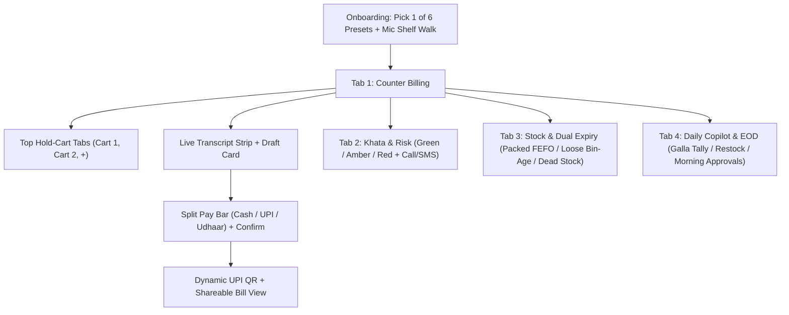

# UI/UX Specification (`apps/web` — Counter-First PWA)

## 1. Design Principles for Indian Retail Counters
1. **One-Handed Thumb Zone:** The primary Push-to-Talk Mic button sits fixed at the bottom center/right (`>= 64px` diameter), reachable while holding a weighing bag in the other hand.
2. **Zero Modal Mazes:** Everything happens on **4 primary tabs**: `Counter`, `Khata`, `Stock & Expiry`, `Copilot & EOD`.
3. **Low-Literacy Visual Clarity:** Minimum `16px` body text, `48px` touch targets, icon + short regional label (`next-intl`), and strict Green/Amber/Red state badges.
4. **Audio Privacy by Default:** Profit margins, wholesale cost prices, drawer cash totals, and Red *udhaar* warnings render **silently on screen** (`suppressTts: true`) so nearby shoppers don't overhear them—spoken only when the owner explicitly triggers `"Bol ke Poocho"` into an earpiece/quiet counter.

---

## 2. Screen Map & User Flows

### Tab 1: Counter Billing (Primary Screen)
* **Top Bar:** Language selector (`HI | EN | MR | GU | TA`), Offline/Synced pill (driven by `Dexie.js`), and **Hold-Cart Tabs** (`Cart 1`, `Cart 2`, `+ Hold`).
* **Transcript Strip:** Shows recognized Hinglish text immediately so the shopkeeper trusts what was heard.
* **Color-Coded Draft Card:**
  * **Green border:** High-confidence SKU & customer matches -> 1-tap **`Confirm (₹180)`** or say `"Haan confirm"`.
  * **Amber chips:** Multiple matches -> large clickable chips (`Ramesh Dudhwala` vs `Ramesh Gali-3`) with one tap to lock.
  * **Red warning banner (discreet):** Appears when adding *udhaar* to an overdue/over-limit customer.
* **Payment Split Row:** Quick-edit `Cash`, `UPI`, `Udhaar` pills + **Due Date pill** (`End of Month` default, tap to change) + **`Show UPI QR`** (`qrcode` generated locally offline).
* **Offline Fallback:** If network drops, quick-tap **Top 12 Frequent SKUs** grid stays usable from `Dexie.js` and queues bills in `pendingDrafts` with a `"Pending Sync"` counter.

### Tab 2: *Khata* & Behavioral Risk
* Searchable customer list sorted by overdue priority with **Traffic Light** badge (`Green`: on-time / monthly-cycle compliant; `Amber`: approaching limit; `Red`: overdue).
* Customer detail drawer shows **Current Bill + Previous Balance** statement (last 10 ledger entries), **`Record Payment`** button, and native **Phone Call** / **`sms:` Reminder** buttons (no WhatsApp dependency in V1).

### Tab 3: Stock, Dual Expiry & Dead Stock
* Toggle between **Packed Batches (FEFO)** (sorted by earliest `expiry_date`, Red badge `<= 5 days`) and **Loose Bins** (freshness progress bar showing days since `bin_last_emptied_at`).
* Top banner highlights **Dead-Stock Capital Lock** (`"₹4,200 locked in 8 items with 0 sales in 30d"`) with a `"Seasonal — Ignore"` action.
* Voice/Tap **Restock Intake** drawer converts `bori`/`peti` into base units and prompts packed expiry date (or category default).

### Tab 4: Daily Copilot & EOD Closing
* **EOD Card:** Side-by-side **`Expected Cash in Galla`** vs **`UPI Received`**, plus 1-tap `Actual Drawer Cash` entry to log variance, and **Supplier-Grouped Restock List**.
* **Morning Card:** Actionable approval cards (Near-expiry 15% clearance markdown, Loose commodity rate advisory, Overdue *udhaar* list) with **`Approve`** / **`Dismiss`** toggles.
